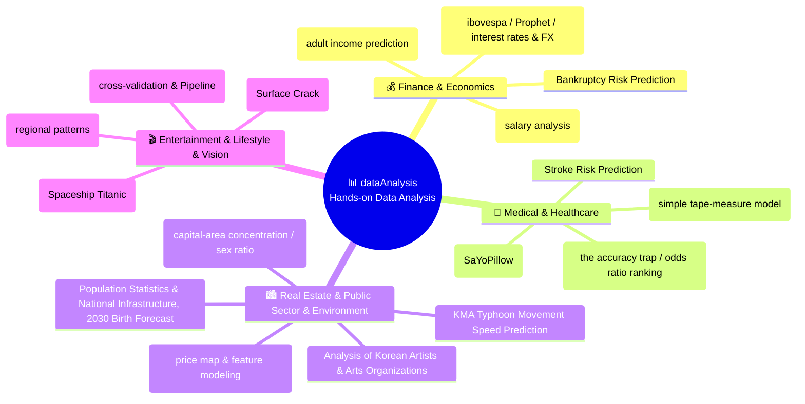

🇰🇷 [한국어](https://github.com/LDJWJ/dataAnalysis/blob/main/README.md) · 🇺🇸 **English** · 🇯🇵 [日本語](README.ja.md)

# 📊 Getting to Know Data: Hands-on Analysis Projects (dataAnalysis)

  
  
  
  
  
  
  

> **A hands-on data analysis (EDA) & machine learning portfolio built on real business, medical, financial and public datasets!**  
> A collection of practical projects covering missing-value handling, feature engineering, interactive Plotly visualization, cross-validation pipelines and predictive modeling, based on data from 17+ different domains sourced from Kaggle and the Korea Public Data Portal.  
> ⭐️ If this helped your learning, please press the **Star** button at the top right!

> **Note:** All slides and notebooks (PDF/HTML) are in Korean. The code itself is language-independent, and your browser's built-in translation (e.g. Chrome) works on the HTML pages.

  <a href="#️-project-map-by-domain">🗺️ Domain Map</a> •
  <a href="#-project-master-index">📋 Master Index</a> •
  <a href="#-1-business--finance--economics">💰 Finance & Economics</a> •
  <a href="#-2-medical--healthcare">🏥 Medical & Healthcare</a> •
  <a href="#️-3-real-estate--public-sector--environment">🏙️ Public & Real Estate</a> •
  <a href="#-4-entertainment--lifestyle--ai">🎬 Entertainment & Lifestyle</a>

---

## 🗺️ Project Map by Domain

---

## 📋 Project Master Index

Every analysis project comes with GitHub source code (`.ipynb`), an **HTML viewer** you can open right in your browser, and links to in-depth follow-up analyses.

| No | Project | Domain | Techniques / Key Models | Data Source | Main Analysis | In-depth Follow-ups |
|:---:|:---|:---:|:---|:---:|:---:|:---:|
| **01** | **Data Scientist Salary Analysis (2023)** | Jobs & Salaries | Salary statistics by role/country, visualization | [Kaggle](https://www.kaggle.com/datasets/arnabchaki/data-science-salaries-2023) | [💻 GitHub](https://github.com/LDJWJ/dataAnalysis/blob/main/01_19_DataScienceSalaries_Analysis_2305.ipynb) · [🌐 HTML](https://ldjwj.github.io/dataAnalysis/01_19_DataScienceSalaries_Analysis_2305.html) | — |
| **02** | **California Housing Price Analysis** | Real Estate | Geographic visualization, regression modeling | Colab Sample | [💻 GitHub](https://github.com/LDJWJ/dataAnalysis/blob/main/01_01_california.ipynb) · [🌐 HTML](https://ldjwj.github.io/dataAnalysis/01_01_california.html) | [🌐 Part 1: Price Map](https://ldjwj.github.io/dataAnalysis/01_01B_california_Price_Map.html) · [🌐 Part 2: Feature Models](https://ldjwj.github.io/dataAnalysis/01_01C_california_Feature_Models.html) |
| **03** | **Kaggle Korea 4th Competition: Adult Income Prediction** | Income & Classification | Feature engineering, One-Hot, LightGBM | [Kaggle](https://www.kaggle.com/c/kakr-4th-competition) | [🌐 Top Solution Review](https://ldjwj.github.io/ML_Basic_Class/part03_ml/part03_pro_kaggle/kaggle_contest_4th_05_1st_review.html) | — |
| **04** | **Stroke Onset Prediction** | Medical | Imbalanced data, logistic regression/trees | [Kaggle](https://www.kaggle.com/datasets/fedesoriano/stroke-prediction-dataset) | [💻 GitHub](https://github.com/LDJWJ/dataAnalysis/blob/main/01_02_Stroke_Prediction_Analysis_01.ipynb) · [🌐 HTML](https://ldjwj.github.io/dataAnalysis/01_02_Stroke_Prediction_Analysis_01.html) | [🌐 Part 1: The Accuracy Trap](https://ldjwj.github.io/dataAnalysis/01_02B_Stroke_Accuracy_Trap.html) |
| **05** | **Bank Bankruptcy Risk Prediction** | Finance | Risk classification modeling, feature transformation | [Kaggle](https://www.kaggle.com/competitions/bankruptcy-risk-prediction) | [💻 GitHub](https://github.com/LDJWJ/dataAnalysis/blob/main/01_03_Bankruptcy_Risk_Prediction02.ipynb) · [🌐 HTML](https://ldjwj.github.io/dataAnalysis/01_03_Bankruptcy_Risk_Prediction04_withkaggle_V10.html) | [📄 PDF Report](https://ldjwj.github.io/dataAnalysis/01_03_Bankruptcy_Risk_Prediction04_withkaggle_V10.pdf) |
| **06** | **Spaceship Titanic Prediction** | Space & Classification | Missing-value imputation, label encoding, ensembles | [Kaggle](https://www.kaggle.com/competitions/spaceship-titanic/data) | [🌐 HTML](https://ldjwj.github.io/dataAnalysis/01_04A_Spaceship_Titanic.html) · [📄 PDF](https://ldjwj.github.io/dataAnalysis/01_04A_Spaceship_Titanic.PDF) | — |
| **07** | **KMA Typhoon Movement Speed Prediction** | Weather | Regression model on time-series weather observations | [KMA](https://data.kma.go.kr/data/weatherIssue/typList.do?pgmNo=724) | [💻 GitHub](https://github.com/LDJWJ/dataAnalysis/blob/main/01_05_Typhoon_analysis.ipynb) · [🌐 HTML](https://ldjwj.github.io/dataAnalysis/01_05_Typhoon_analysis.html) | — |
| **08** | **Wine Quality Classification** | Food & Chemistry | Multiclass classification, correlation analysis | [Kaggle](https://www.kaggle.com/datasets/yasserh/wine-quality-dataset?select=WineQT.csv) | [💻 GitHub](https://github.com/LDJWJ/dataAnalysis/blob/main/01_06_WindQT_DataAnalysis.ipynb) · [🌐 HTML](https://ldjwj.github.io/dataAnalysis/01_06_WindQT_DataAnalysis.html) | [🌐 Part 1: Cross-Validation & Pipelines](https://ldjwj.github.io/dataAnalysis/01_06B_WineQT_CrossVal_Pipeline.html) |
| **09** | **Human Stress Detection from Sleep Sensors** | Healthcare | Multi-sensor classification (SaYoPillow) | [Kaggle](https://www.kaggle.com/datasets/laavanya/human-stress-detection-in-and-through-sleep?select=SaYoPillow.csv) | [💻 GitHub](https://github.com/LDJWJ/dataAnalysis/blob/main/01_07_Human_Stress_Detection.ipynb) · [🌐 HTML](https://ldjwj.github.io/dataAnalysis/01_07_Human_Stress_Detection.html) | [🌐 Part 1: Correlation & Decision Trees](https://ldjwj.github.io/dataAnalysis/01_07B_Human_Stress_Correlation_Tree.html) |
| **10** | **Brazilian Stock Market (ibovespa) Price Forecasting** | Securities & Time Series | Time-series analysis & Meta Prophet | [Kaggle](https://www.kaggle.com/datasets/felsal/ibovespa-stocks) | [💻 GitHub](https://github.com/LDJWJ/dataAnalysis/blob/main/01_08_ivospa_stock.ipynb) · [🌐 HTML Prophet](https://ldjwj.github.io/dataAnalysis/01_08B_ivospa_stock_Prophet.html) | [🌐 Part 1: Interest Rates, FX & Stock Prices](https://ldjwj.github.io/dataAnalysis/01_08D_ibovespa_Rates_FX_Stock.html) |
| **11** | **Body Fat Prediction from Male Body Measurements** | Health & Fitness | Multiple linear regression, multicollinearity diagnostics | [Kaggle](https://www.kaggle.com/datasets/fedesoriano/body-fat-prediction-dataset) | [💻 GitHub](https://github.com/LDJWJ/dataAnalysis/blob/main/01_09_bodyFatPredict.ipynb) · [🌐 HTML](https://ldjwj.github.io/dataAnalysis/01_09_bodyFatPredict.html) | [🌐 Part 1: Simple Tape-Measure Model](https://ldjwj.github.io/dataAnalysis/01_09B_bodyFat_Simple_Tape_Model.html) |
| **12** | **Key Indicators of Heart Disease in 400K CDC Adults** | Medicine & Epidemiology | Binary classification on large-scale survey data | [Kaggle](https://www.kaggle.com/datasets/kamilpytlak/personal-key-indicators-of-heart-disease) | [💻 GitHub](https://github.com/LDJWJ/dataAnalysis/blob/main/01_10_Heart_Disease.ipynb) · [🌐 HTML](https://ldjwj.github.io/dataAnalysis/01_10_Heart_Disease.html) | [🌐 Part 1: Threshold Tuning](https://ldjwj.github.io/dataAnalysis/01_10B_Heart_Disease_Accuracy_Trap_Modeling.html) · [🌐 Part 2: Odds Ratio Ranking](https://ldjwj.github.io/dataAnalysis/01_10C_Heart_Disease_Risk_Factors.html) |
| **13** | **MCU Marvel Movie Box Office Analysis** | Entertainment | Worldwide box office revenue comparison, visualization | [Kaggle](https://www.kaggle.com/datasets/mayureshkoli/mcu-worldwide-box-office-collection) | [💻 GitHub Model](https://github.com/LDJWJ/dataAnalysis/blob/main/01_11_MCU_MOVIE_INFO.ipynb) · [🌐 HTML EDA](https://ldjwj.github.io/dataAnalysis/01_11_MCU_MOVIE_INFO_02.html) | [🌐 Part 1: Regional Patterns & ROI](https://ldjwj.github.io/dataAnalysis/01_11B_MCU_Regional_Box_Office_Patterns.html) |
| **14** | **Population Statistics & National Infrastructure Analysis** | Public Sector & Population | Long-term population change & 2030 birth forecast | KOSIS / MOLIT | [🌐 HTML EDA](https://ldjwj.github.io/dataAnalysis/01_12_Population_Analysis01_EDA.html) · [📄 PDF](https://ldjwj.github.io/dataAnalysis/01_12_Population_Analysis01_EDA.pdf) | [🌐 2030 Birth Forecast](https://ldjwj.github.io/dataAnalysis/01_12_Population_Analysis02.html) |
| **15** | **Analysis of Korean Artists & Arts Organizations** | Culture & Statistics | Registration trends of entertainment management agencies & archive | KOCCA (Korea Creative Content Agency) | [🌐 HTML EDA](https://ldjwj.github.io/dataAnalysis/01_14_Artist_Kor_analysis01_EDA.html) | — |
| **16** | **MOIS Resident Registration Population Statistics** | Public Sector & Statistics | Population distribution by age group/region | MOIS (Ministry of the Interior and Safety) | [🌐 HTML](https://ldjwj.github.io/dataAnalysis/01_15_Population_Data.html) | [🌐 Part 1: Capital-Area Concentration & Sex Ratio](https://ldjwj.github.io/dataAnalysis/01_15B_Population_Data_Analysis.html) |
| **17** | **Concrete Surface Crack Detection (CV)** | Construction & Vision | Crack detection on a 20,000-image dataset | [Kaggle](https://www.kaggle.com/datasets/arunrk7/surface-crack-detection) | Coming soon | — |

---

## 💰 1. Business · Finance · Economics

* **Data Science Salaries 2023**:
  * A comparative analysis of 2023 salaries for data scientists, engineers and analysts worldwide, broken down by role, experience level and company size.
  * [💻 GitHub Code](https://github.com/LDJWJ/dataAnalysis/blob/main/01_19_DataScienceSalaries_Analysis_2305.ipynb) · [🌐 HTML Report](https://ldjwj.github.io/dataAnalysis/01_19_DataScienceSalaries_Analysis_2305.html)
* **Bank Bankruptcy Risk Prediction**:
  * A risk-management model that predicts in advance the bankruptcy risk of companies/individuals from financial ratio data.
  * [🌐 HTML Basics](https://ldjwj.github.io/dataAnalysis/01_03_Bankruptcy_Risk_Prediction01_v10_220518.html) · [🌐 HTML Modeling](https://ldjwj.github.io/dataAnalysis/01_03_Bankruptcy_Risk_Prediction04_withkaggle_V10.html) · [📄 PDF](https://ldjwj.github.io/dataAnalysis/01_03_Bankruptcy_Risk_Prediction04_withkaggle_V10.pdf)
* **Brazilian Stock Exchange (ibovespa) Time-Series Analysis & Prophet Forecasting**:
  * Exploring price trends and moving averages, and forecasting future prices with Meta Prophet.
  * [💻 GitHub Basics](https://github.com/LDJWJ/dataAnalysis/blob/main/01_08_ivospa_stock.ipynb) · [🌐 HTML Prophet](https://ldjwj.github.io/dataAnalysis/01_08B_ivospa_stock_Prophet.html)
  * **[Follow-up]** Correlation and lagged correlation between interest rates, FX and stock prices, plus a target-leakage check: [🌐 HTML Follow-up](https://ldjwj.github.io/dataAnalysis/01_08D_ibovespa_Rates_FX_Stock.html)

---

## 🏥 2. Medical · Healthcare

* **Stroke Onset Prediction**:
  * Classifies the probability of a stroke from lifestyle variables such as age, hypertension, heart disease and smoking status.
  * [💻 GitHub Code](https://github.com/LDJWJ/dataAnalysis/blob/main/01_02_Stroke_Prediction_Analysis_01.ipynb) · [🌐 HTML Basics](https://ldjwj.github.io/dataAnalysis/01_02_Stroke_Prediction_Analysis_01.html)
  * **[Follow-up]** The Accuracy Trap ① - confusion matrix on imbalanced data, ROC-AUC and threshold search: [🌐 HTML Follow-up](https://ldjwj.github.io/dataAnalysis/01_02B_Stroke_Accuracy_Trap.html)
* **Human Stress Detection During Sleep (SaYoPillow)**:
  * Automatically determines stress levels by combining sensor data on sleeping posture, body temperature and heart rate.
  * [💻 GitHub Basics](https://github.com/LDJWJ/dataAnalysis/blob/main/01_07_Human_Stress_Detection.ipynb) · [🌐 HTML Basics](https://ldjwj.github.io/dataAnalysis/01_07_Human_Stress_Detection.html)
  * **[Follow-up]** Correlation heatmap and decision-tree-based feature importance analysis: [🌐 HTML Follow-up](https://ldjwj.github.io/dataAnalysis/01_07B_Human_Stress_Correlation_Tree.html)
* **CDC Key Indicators of Heart Disease (Personal Key Indicators)**:
  * Identifying high-risk groups using a massive U.S. CDC adult survey dataset of 400,000 people.
  * [💻 GitHub Basics](https://github.com/LDJWJ/dataAnalysis/blob/main/01_10_Heart_Disease.ipynb) · [🌐 HTML Basics](https://ldjwj.github.io/dataAnalysis/01_10_Heart_Disease.html)
  * **[Follow-up Part 1]** The Accuracy Trap ② - optimizing class_weight and the decision threshold: [🌐 HTML Part 1](https://ldjwj.github.io/dataAnalysis/01_10B_Heart_Disease_Accuracy_Trap_Modeling.html)
  * **[Follow-up Part 2]** Risk factor analysis and logistic regression Odds Ratio ranking (Plotly): [🌐 HTML Part 2](https://ldjwj.github.io/dataAnalysis/01_10C_Heart_Disease_Risk_Factors.html)
* **Body Fat Percentage Prediction**:
  * Multiple regression modeling that estimates body fat percentage precisely from body circumference measurements of 252 men.
  * [💻 GitHub Basics](https://github.com/LDJWJ/dataAnalysis/blob/main/01_09_bodyFatPredict.ipynb) · [🌐 HTML Basics](https://ldjwj.github.io/dataAnalysis/01_09_bodyFatPredict.html)
  * **[Follow-up Part 1]** Deriving simple, cross-validated formulas from combinations of 1–3 variables you can measure with a tape measure: [🌐 HTML Part 1](https://ldjwj.github.io/dataAnalysis/01_09B_bodyFat_Simple_Tape_Model.html)

---

## 🏙️ 3. Real Estate · Public Sector · Environment

* **California Housing Price Regression Analysis**:
  * A standard benchmark for house price prediction that reflects income level, proximity to the ocean and rooms per household.
  * [💻 GitHub Basics](https://github.com/LDJWJ/dataAnalysis/blob/main/01_01_california.ipynb) · [🌐 HTML Basics](https://ldjwj.github.io/dataAnalysis/01_01_california.html)
  * **[Follow-up Part 1]** Geographic map visualization of California house prices by latitude/longitude: [🌐 HTML Part 1](https://ldjwj.github.io/dataAnalysis/01_01B_california_Price_Map.html)
  * **[Follow-up Part 2]** Feature selection and comparison of multiple regression models: [🌐 HTML Part 2](https://ldjwj.github.io/dataAnalysis/01_01C_california_Feature_Models.html)
* **South Korean Population Statistics & National Infrastructure (Roads/Bridges) Analysis**:
  * Combines long-term population data from 1970–2021 with statistics on bridges/tunnels completed between 1926 and 2021 to build a **2030 birth forecast model**.
  

    
    
  

  * [🌐 HTML Exploration (EDA)](https://ldjwj.github.io/dataAnalysis/01_12_Population_Analysis01_EDA.html) · [🌐 HTML 2030 Forecast](https://ldjwj.github.io/dataAnalysis/01_12_Population_Analysis02.html) · [📄 PDF](https://ldjwj.github.io/dataAnalysis/01_12_Population_Analysis01_EDA.pdf)
* **MOIS Resident Registration Population Statistics**:
  * Analysis of resident registration population by administrative district (total population, number of households, sex) as of October 2023.
  

    
  

  * [🌐 HTML Basics](https://ldjwj.github.io/dataAnalysis/01_15_Population_Data.html)
  * **[Follow-up Part 1]** Capital-area concentration, population ranking by province, and a Plotly treemap of sex ratio and persons per household: [🌐 HTML Part 1](https://ldjwj.github.io/dataAnalysis/01_15B_Population_Data_Analysis.html)
* **Analysis of Korean Artists & Arts Organizations**:
  * Exploring registration data for popular culture & arts management businesses and digital archive data.
  

    
  

  * [🌐 HTML Report](https://ldjwj.github.io/dataAnalysis/01_14_Artist_Kor_analysis01_EDA.html)
* **KMA Typhoon Movement Speed Prediction**:
  * Predicting movement speed using historical typhoon tracks and central pressure data from the Korea Meteorological Administration (KMA).
  * [💻 GitHub Code](https://github.com/LDJWJ/dataAnalysis/blob/main/01_05_Typhoon_analysis.ipynb) · [🌐 HTML Report](https://ldjwj.github.io/dataAnalysis/01_05_Typhoon_analysis.html)

---

## 🎬 4. Entertainment · Lifestyle · AI

* **MCU Marvel Movies Worldwide Box Office Analysis**:
  * A comparative analysis of production budgets, worldwide opening and cumulative box office revenue for Marvel films from Iron Man to the latest releases.
  * [💻 GitHub Model](https://github.com/LDJWJ/dataAnalysis/blob/main/01_11_MCU_MOVIE_INFO.ipynb) · [🌐 HTML EDA](https://ldjwj.github.io/dataAnalysis/01_11_MCU_MOVIE_INFO_02.html)
  * **[Follow-up Part 1]** Diagnosing regression overfitting, plus Plotly visualizations of regional box office share and return on budget (ROI): [🌐 HTML Part 1](https://ldjwj.github.io/dataAnalysis/01_11B_MCU_Regional_Box_Office_Patterns.html)
* **Wine Quality Classification**:
  * Classifying wine quality from a combination of 11 physicochemical properties such as acidity, alcohol content and residual sugar.
  * [💻 GitHub Basics](https://github.com/LDJWJ/dataAnalysis/blob/main/01_06_WindQT_DataAnalysis.ipynb) · [🌐 HTML Basics](https://ldjwj.github.io/dataAnalysis/01_06_WindQT_DataAnalysis.html)
  * **[Follow-up Part 1]** Model optimization with k-fold cross-validation and a Scikit-learn Pipeline: [🌐 HTML Part 1](https://ldjwj.github.io/dataAnalysis/01_06B_WineQT_CrossVal_Pipeline.html)
* **Spaceship Titanic: Predicting Which Passengers Were Transported to Another Dimension**:
  * Hands-on Kaggle competition modeling with missing-value imputation and derived-feature engineering.
  * [🌐 HTML Report](https://ldjwj.github.io/dataAnalysis/01_04A_Spaceship_Titanic.html) · [📄 PDF](https://ldjwj.github.io/dataAnalysis/01_04A_Spaceship_Titanic.PDF)

---

## 🔗 License & Contact

* **Contact**: For data analysis collaboration and partnership inquiries: [frontier1020@naver.com](mailto:frontier1020@naver.com)
* **License**: All materials in this repository are licensed under [CC BY-NC 4.0](LICENSE). You are free to use them for non-commercial purposes as long as you give appropriate credit.
