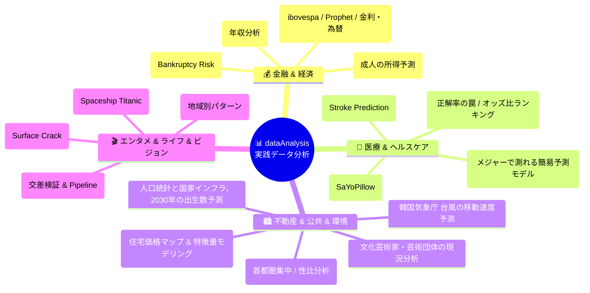

🇰🇷 [한국어](https://github.com/LDJWJ/dataAnalysis/blob/main/README.md) · 🇺🇸 [English](README.en.md) · 🇯🇵 **日本語**

# 📊 データを知る 実践分析プロジェクト (dataAnalysis)

  
  
  
  
  
  
  

> **実際のビジネス・医療・金融・公共データセットで仕上げる、実践データ分析（EDA）＆機械学習ポートフォリオ！**  
> Kaggle と韓国の公共データポータルにある 17 以上の多様なドメインのデータをもとに、欠損値処理、特徴量エンジニアリング、Plotly によるインタラクティブな可視化、交差検証パイプライン、予測モデリングを行った実践プロジェクト集です。  
> ⭐️ 役に立ったら、右上の **Star** ボタンを押していただけるとうれしいです！

> **補足：** 教材（PDF/HTML）はすべて韓国語です。コード自体は言語に依存せずそのまま動作し、HTMLページはブラウザ（Chromeなど）の自動翻訳で読めます。

  <a href="#️-ドメイン別プロジェクトマップ">🗺️ ドメインマップ</a> •
  <a href="#-プロジェクトマスターインデックス">📋 マスターインデックス</a> •
  <a href="#-1-ビジネス金融経済ドメイン">💰 金融・経済</a> •
  <a href="#-2-医療ヘルスケアドメイン">🏥 医療・ヘルスケア</a> •
  <a href="#️-3-不動産公共環境ドメイン">🏙️ 公共・不動産</a> •
  <a href="#-4-エンターテインメントライフai">🎬 エンタメ・ライフ</a>

---

## 🗺️ ドメイン別プロジェクトマップ

---

## 📋 プロジェクト・マスターインデックス

すべての分析プロジェクトに、GitHub のソースコード（`.ipynb`）、ブラウザですぐに閲覧できる **HTML ビューア**、発展的な追加分析へのリンクを用意しています。

| No | プロジェクト名 | ドメイン | 分析手法 / 主なモデル | データ出典 | 基本分析リンク | 追加分析リンク |
|:---:|:---|:---:|:---|:---:|:---:|:---:|
| **01** | **データサイエンティストの年収分析（2023）** | 就職・年収 | 職種別/国別の給与統計、可視化 | [Kaggle](https://www.kaggle.com/datasets/arnabchaki/data-science-salaries-2023) | [💻 GitHub](https://github.com/LDJWJ/dataAnalysis/blob/main/01_19_DataScienceSalaries_Analysis_2305.ipynb) · [🌐 HTML](https://ldjwj.github.io/dataAnalysis/01_19_DataScienceSalaries_Analysis_2305.html) | — |
| **02** | **カリフォルニア住宅価格分析** | 不動産 | 地理的可視化、回帰モデリング | Colab Sample | [💻 GitHub](https://github.com/LDJWJ/dataAnalysis/blob/main/01_01_california.ipynb) · [🌐 HTML](https://ldjwj.github.io/dataAnalysis/01_01_california.html) | [🌐 第1回：住宅価格マップ](https://ldjwj.github.io/dataAnalysis/01_01B_california_Price_Map.html) · [🌐 第2回：特徴量モデル](https://ldjwj.github.io/dataAnalysis/01_01C_california_Feature_Models.html) |
| **03** | **Kaggle Korea 第4回 成人の所得予測** | 所得・分類 | 特徴量エンジニアリング、One-Hot、LightGBM | [Kaggle](https://www.kaggle.com/c/kakr-4th-competition) | [🌐 上位解法分析](https://ldjwj.github.io/ML_Basic_Class/part03_ml/part03_pro_kaggle/kaggle_contest_4th_05_1st_review.html) | — |
| **04** | **脳卒中（Stroke）の発症予測** | 医療 | 不均衡データ、ロジスティック回帰/決定木 | [Kaggle](https://www.kaggle.com/datasets/fedesoriano/stroke-prediction-dataset) | [💻 GitHub](https://github.com/LDJWJ/dataAnalysis/blob/main/01_02_Stroke_Prediction_Analysis_01.ipynb) · [🌐 HTML](https://ldjwj.github.io/dataAnalysis/01_02_Stroke_Prediction_Analysis_01.html) | [🌐 第1回：正解率の罠](https://ldjwj.github.io/dataAnalysis/01_02B_Stroke_Accuracy_Trap.html) |
| **05** | **銀行の破綻リスク予測** | 金融 | リスク分類モデリング、特徴量変換 | [Kaggle](https://www.kaggle.com/competitions/bankruptcy-risk-prediction) | [💻 GitHub](https://github.com/LDJWJ/dataAnalysis/blob/main/01_03_Bankruptcy_Risk_Prediction02.ipynb) · [🌐 HTML](https://ldjwj.github.io/dataAnalysis/01_03_Bankruptcy_Risk_Prediction04_withkaggle_V10.html) | [📄 PDF レポート](https://ldjwj.github.io/dataAnalysis/01_03_Bankruptcy_Risk_Prediction04_withkaggle_V10.pdf) |
| **06** | **Spaceship Titanic 予測** | 宇宙・分類 | 欠損値補完、ラベルエンコーディング、アンサンブル | [Kaggle](https://www.kaggle.com/competitions/spaceship-titanic/data) | [🌐 HTML](https://ldjwj.github.io/dataAnalysis/01_04A_Spaceship_Titanic.html) · [📄 PDF](https://ldjwj.github.io/dataAnalysis/01_04A_Spaceship_Titanic.PDF) | — |
| **07** | **韓国気象庁 台風の移動速度予測** | 気象 | 時系列の気象観測データによる回帰モデル | [韓国気象庁](https://data.kma.go.kr/data/weatherIssue/typList.do?pgmNo=724) | [💻 GitHub](https://github.com/LDJWJ/dataAnalysis/blob/main/01_05_Typhoon_analysis.ipynb) · [🌐 HTML](https://ldjwj.github.io/dataAnalysis/01_05_Typhoon_analysis.html) | — |
| **08** | **ワイン品質（Wine Quality）の判別** | 食品・化学 | 多クラス分類、相関分析 | [Kaggle](https://www.kaggle.com/datasets/yasserh/wine-quality-dataset?select=WineQT.csv) | [💻 GitHub](https://github.com/LDJWJ/dataAnalysis/blob/main/01_06_WindQT_DataAnalysis.ipynb) · [🌐 HTML](https://ldjwj.github.io/dataAnalysis/01_06_WindQT_DataAnalysis.html) | [🌐 第1回：交差検証 & パイプライン](https://ldjwj.github.io/dataAnalysis/01_06B_WineQT_CrossVal_Pipeline.html) |
| **09** | **睡眠センサーによる人間のストレス検知** | ヘルスケア | マルチセンサー分類（SaYoPillow） | [Kaggle](https://www.kaggle.com/datasets/laavanya/human-stress-detection-in-and-through-sleep?select=SaYoPillow.csv) | [💻 GitHub](https://github.com/LDJWJ/dataAnalysis/blob/main/01_07_Human_Stress_Detection.ipynb) · [🌐 HTML](https://ldjwj.github.io/dataAnalysis/01_07_Human_Stress_Detection.html) | [🌐 第1回：相関関係 & 決定木](https://ldjwj.github.io/dataAnalysis/01_07B_Human_Stress_Correlation_Tree.html) |
| **10** | **ブラジル株式市場（ibovespa）の株価予測** | 証券・時系列 | 時系列分析 & Meta Prophet | [Kaggle](https://www.kaggle.com/datasets/felsal/ibovespa-stocks) | [💻 GitHub](https://github.com/LDJWJ/dataAnalysis/blob/main/01_08_ivospa_stock.ipynb) · [🌐 HTML Prophet](https://ldjwj.github.io/dataAnalysis/01_08B_ivospa_stock_Prophet.html) | [🌐 第1回：金利・為替と株価](https://ldjwj.github.io/dataAnalysis/01_08D_ibovespa_Rates_FX_Stock.html) |
| **11** | **男性の身体寸法にもとづく体脂肪率予測** | 健康・フィットネス | 重回帰分析、多重共線性の診断 | [Kaggle](https://www.kaggle.com/datasets/fedesoriano/body-fat-prediction-dataset) | [💻 GitHub](https://github.com/LDJWJ/dataAnalysis/blob/main/01_09_bodyFatPredict.ipynb) · [🌐 HTML](https://ldjwj.github.io/dataAnalysis/01_09_bodyFatPredict.html) | [🌐 第1回：メジャーで測れる簡易モデル](https://ldjwj.github.io/dataAnalysis/01_09B_bodyFat_Simple_Tape_Model.html) |
| **12** | **CDC 成人40万人の心臓病主要指標** | 医療・疫学 | 大規模アンケートデータの二値分類 | [Kaggle](https://www.kaggle.com/datasets/kamilpytlak/personal-key-indicators-of-heart-disease) | [💻 GitHub](https://github.com/LDJWJ/dataAnalysis/blob/main/01_10_Heart_Disease.ipynb) · [🌐 HTML](https://ldjwj.github.io/dataAnalysis/01_10_Heart_Disease.html) | [🌐 第1回：しきい値の調整](https://ldjwj.github.io/dataAnalysis/01_10B_Heart_Disease_Accuracy_Trap_Modeling.html) · [🌐 第2回：オッズ比ランキング](https://ldjwj.github.io/dataAnalysis/01_10C_Heart_Disease_Risk_Factors.html) |
| **13** | **MCU マーベル映画の興行収入分析** | エンターテインメント | 世界興行収入の比較、可視化 | [Kaggle](https://www.kaggle.com/datasets/mayureshkoli/mcu-worldwide-box-office-collection) | [💻 GitHub モデル](https://github.com/LDJWJ/dataAnalysis/blob/main/01_11_MCU_MOVIE_INFO.ipynb) · [🌐 HTML EDA](https://ldjwj.github.io/dataAnalysis/01_11_MCU_MOVIE_INFO_02.html) | [🌐 第1回：地域別パターン & 収益率](https://ldjwj.github.io/dataAnalysis/01_11B_MCU_Regional_Box_Office_Patterns.html) |
| **14** | **人口統計と国家インフラの分析** | 公共・人口 | 長期的な人口変化 & 2030年の出生数予測 | KOSIS / 韓国国土交通部 | [🌐 HTML EDA](https://ldjwj.github.io/dataAnalysis/01_12_Population_Analysis01_EDA.html) · [📄 PDF](https://ldjwj.github.io/dataAnalysis/01_12_Population_Analysis01_EDA.pdf) | [🌐 2030年の出生数予測](https://ldjwj.github.io/dataAnalysis/01_12_Population_Analysis02.html) |
| **15** | **文化芸術家・芸術団体の現況分析** | 文化・統計 | 芸能企画業の登録推移とアーカイブ | 韓国コンテンツ振興院 | [🌐 HTML EDA](https://ldjwj.github.io/dataAnalysis/01_14_Artist_Kor_analysis01_EDA.html) | — |
| **16** | **韓国行政安全部 住民登録人口統計** | 公共・統計 | 年齢層別/地域別の人口分布分析 | 韓国行政安全部 | [🌐 HTML](https://ldjwj.github.io/dataAnalysis/01_15_Population_Data.html) | [🌐 第1回：首都圏集中 & 性比](https://ldjwj.github.io/dataAnalysis/01_15B_Population_Data_Analysis.html) |
| **17** | **コンクリート表面のひび割れ検出（CV）** | 建築・ビジョン | 2万枚の画像データセットによるひび割れ検出 | [Kaggle](https://www.kaggle.com/datasets/arunrk7/surface-crack-detection) | 準備中 | — |

---

## 💰 1. ビジネス・金融・経済ドメイン

* **Data Science Salaries 2023（データサイエンティストの年収）**:
  * 2023年のデータサイエンティスト、エンジニア、アナリストの年収を、世界の職種別・経験別・企業規模別に比較分析します。
  * [💻 GitHub コード](https://github.com/LDJWJ/dataAnalysis/blob/main/01_19_DataScienceSalaries_Analysis_2305.ipynb) · [🌐 HTML レポート](https://ldjwj.github.io/dataAnalysis/01_19_DataScienceSalaries_Analysis_2305.html)
* **銀行の破綻リスク予測（Bankruptcy Risk Prediction）**:
  * 財務比率データをもとに、企業/個人の破綻リスクを事前に予測するリスク管理モデルです。
  * [🌐 HTML 基礎](https://ldjwj.github.io/dataAnalysis/01_03_Bankruptcy_Risk_Prediction01_v10_220518.html) · [🌐 HTML モデリング](https://ldjwj.github.io/dataAnalysis/01_03_Bankruptcy_Risk_Prediction04_withkaggle_V10.html) · [📄 PDF](https://ldjwj.github.io/dataAnalysis/01_03_Bankruptcy_Risk_Prediction04_withkaggle_V10.pdf)
* **ブラジル証券取引所（ibovespa）の時系列分析 & Prophet 予測**:
  * 株価のトレンドと移動平均線を探索し、Meta Prophet で将来の株価を予測します。
  * [💻 GitHub 基本](https://github.com/LDJWJ/dataAnalysis/blob/main/01_08_ivospa_stock.ipynb) · [🌐 HTML Prophet](https://ldjwj.github.io/dataAnalysis/01_08B_ivospa_stock_Prophet.html)
  * **[追加分析]** 金利・為替と株価の相関/ラグ相関、およびデータリーケージ（正解の漏洩）のチェック: [🌐 HTML 追加分析](https://ldjwj.github.io/dataAnalysis/01_08D_ibovespa_Rates_FX_Stock.html)

---

## 🏥 2. 医療・ヘルスケアドメイン

* **脳卒中（Stroke）の発症予測**:
  * 年齢、高血圧、心疾患の有無、喫煙状況などのライフスタイル変数をもとに、脳卒中の発症確率を分類します。
  * [💻 GitHub コード](https://github.com/LDJWJ/dataAnalysis/blob/main/01_02_Stroke_Prediction_Analysis_01.ipynb) · [🌐 HTML 基本](https://ldjwj.github.io/dataAnalysis/01_02_Stroke_Prediction_Analysis_01.html)
  * **[追加分析]** 正解率の罠 ① - 不均衡データの混同行列、ROC-AUC、しきい値の探索: [🌐 HTML 追加分析](https://ldjwj.github.io/dataAnalysis/01_02B_Stroke_Accuracy_Trap.html)
* **睡眠中の人間のストレス検知（SaYoPillow）**:
  * 睡眠姿勢、体温、心拍数のセンサーデータを組み合わせて、ストレスレベルを自動で判別します。
  * [💻 GitHub 基本](https://github.com/LDJWJ/dataAnalysis/blob/main/01_07_Human_Stress_Detection.ipynb) · [🌐 HTML 基本](https://ldjwj.github.io/dataAnalysis/01_07_Human_Stress_Detection.html)
  * **[追加分析]** 相関係数ヒートマップと、決定木にもとづく主要変数の重要度分析: [🌐 HTML 追加分析](https://ldjwj.github.io/dataAnalysis/01_07B_Human_Stress_Correlation_Tree.html)
* **CDC 心臓病の主要指標分析（Personal Key Indicators）**:
  * 40万人分に及ぶ米国 CDC の成人アンケート調査データを活用して、高リスク群を探索します。
  * [💻 GitHub 基本](https://github.com/LDJWJ/dataAnalysis/blob/main/01_10_Heart_Disease.ipynb) · [🌐 HTML 基本](https://ldjwj.github.io/dataAnalysis/01_10_Heart_Disease.html)
  * **[追加分析 第1回]** 正解率の罠 ② - class_weight としきい値の最適化: [🌐 HTML 第1回](https://ldjwj.github.io/dataAnalysis/01_10B_Heart_Disease_Accuracy_Trap_Modeling.html)
  * **[追加分析 第2回]** リスク要因の分析と、ロジスティック回帰のオッズ比（Odds Ratio）ランキング（Plotly）: [🌐 HTML 第2回](https://ldjwj.github.io/dataAnalysis/01_10C_Heart_Disease_Risk_Factors.html)
* **体脂肪率（Body Fat）の予測**:
  * 男性252人の身体周囲径の測定値をもとに、体脂肪率を精密に導き出す重回帰モデリングです。
  * [💻 GitHub 基本](https://github.com/LDJWJ/dataAnalysis/blob/main/01_09_bodyFatPredict.ipynb) · [🌐 HTML 基本](https://ldjwj.github.io/dataAnalysis/01_09_bodyFatPredict.html)
  * **[追加分析 第1回]** メジャーで測れる1〜3個の変数の組み合わせを交差検証し、簡単な計算式を導出: [🌐 HTML 第1回](https://ldjwj.github.io/dataAnalysis/01_09B_bodyFat_Simple_Tape_Model.html)

---

## 🏙️ 3. 不動産・公共・環境ドメイン

* **カリフォルニア住宅価格の回帰分析**:
  * 所得水準、海岸へのアクセス、世帯あたりの部屋数を反映した、住宅価格予測の標準的なベンチマークです。
  * [💻 GitHub 基本](https://github.com/LDJWJ/dataAnalysis/blob/main/01_01_california.ipynb) · [🌐 HTML 基本](https://ldjwj.github.io/dataAnalysis/01_01_california.html)
  * **[追加分析 第1回]** 緯度・経度にもとづくカリフォルニア住宅価格の地図可視化: [🌐 HTML 第1回](https://ldjwj.github.io/dataAnalysis/01_01B_california_Price_Map.html)
  * **[追加分析 第2回]** 特徴量選択と複数の回帰モデルの比較: [🌐 HTML 第2回](https://ldjwj.github.io/dataAnalysis/01_01C_california_Feature_Models.html)
* **韓国の人口統計 & 国家インフラ（道路/橋梁）分析**:
  * 1970〜2021年の長期人口データと、1926〜2021年に完成した橋梁/トンネルの統計を組み合わせ、**2030年の出生数予測モデル** を構築します。
  

    
    
  

  * [🌐 HTML 探索（EDA）](https://ldjwj.github.io/dataAnalysis/01_12_Population_Analysis01_EDA.html) · [🌐 HTML 2030年予測](https://ldjwj.github.io/dataAnalysis/01_12_Population_Analysis02.html) · [📄 PDF](https://ldjwj.github.io/dataAnalysis/01_12_Population_Analysis01_EDA.pdf)
* **韓国行政安全部 住民登録人口統計**:
  * 2023年10月時点の行政区域別の住民登録人口（総人口、世帯数、性別）を分析します。
  

    
  

  * [🌐 HTML 基本](https://ldjwj.github.io/dataAnalysis/01_15_Population_Data.html)
  * **[追加分析 第1回]** 首都圏への集中度、市・道別の人口ランキング、性比・世帯あたり人数の Plotly ツリーマップ: [🌐 HTML 第1回](https://ldjwj.github.io/dataAnalysis/01_15B_Population_Data_Analysis.html)
* **文化芸術家・芸術団体の現況分析**:
  * 大衆文化芸術企画業の登録状況と、デジタルアーカイブのデータを探索します。
  

    
  

  * [🌐 HTML レポート](https://ldjwj.github.io/dataAnalysis/01_14_Artist_Kor_analysis01_EDA.html)
* **韓国気象庁 台風の移動速度予測**:
  * 韓国気象庁の過去の台風経路と中心気圧のデータを活用して、移動速度を予測します。
  * [💻 GitHub コード](https://github.com/LDJWJ/dataAnalysis/blob/main/01_05_Typhoon_analysis.ipynb) · [🌐 HTML レポート](https://ldjwj.github.io/dataAnalysis/01_05_Typhoon_analysis.html)

---

## 🎬 4. エンターテインメント・ライフ・AI

* **MCU マーベル映画 世界興行収入分析**:
  * 『アイアンマン』から最新作までのマーベル映画について、製作費、全世界のオープニング興収および累計興行収入を比較分析します。
  * [💻 GitHub モデル](https://github.com/LDJWJ/dataAnalysis/blob/main/01_11_MCU_MOVIE_INFO.ipynb) · [🌐 HTML EDA](https://ldjwj.github.io/dataAnalysis/01_11_MCU_MOVIE_INFO_02.html)
  * **[追加分析 第1回]** 回帰モデルの過学習の診断、地域別の興収比率と予算に対する収益率（ROI）の Plotly 可視化: [🌐 HTML 第1回](https://ldjwj.github.io/dataAnalysis/01_11B_MCU_Regional_Box_Office_Patterns.html)
* **ワイン品質（Wine Quality）の判別**:
  * 酸度、アルコール度数、残糖など11種類の物理化学的特性を組み合わせて、ワインの品質を分類します。
  * [💻 GitHub 基本](https://github.com/LDJWJ/dataAnalysis/blob/main/01_06_WindQT_DataAnalysis.ipynb) · [🌐 HTML 基本](https://ldjwj.github.io/dataAnalysis/01_06_WindQT_DataAnalysis.html)
  * **[追加分析 第1回]** k-fold 交差検証と Scikit-learn Pipeline によるモデルの最適化: [🌐 HTML 第1回](https://ldjwj.github.io/dataAnalysis/01_06B_WineQT_CrossVal_Pipeline.html)
* **宇宙船タイタニック（Spaceship Titanic）乗客の異次元転送予測**:
  * 欠損値の補完と派生変数のエンジニアリングによる、Kaggle コンペの実践モデリングです。
  * [🌐 HTML レポート](https://ldjwj.github.io/dataAnalysis/01_04A_Spaceship_Titanic.html) · [📄 PDF](https://ldjwj.github.io/dataAnalysis/01_04A_Spaceship_Titanic.PDF)

---

## 🔗 ライセンスとお問い合わせ

* **お問い合わせ**: データ分析の協業・提携に関するお問い合わせ: [frontier1020@naver.com](mailto:frontier1020@naver.com)
* **ライセンス**: 本リポジトリのために作成した分析ノートブック・HTML・PDF は [CC BY-NC 4.0](LICENSE) ライセンスに従います。出典を明記すれば、非営利目的で自由にご活用いただけます。
* **第三者の資料**: `data/` フォルダのデータ（Kaggle・公共データなど、出典は [data/README.md](data/README.md)）と `spaceship-titanic-eda-27-different-models.ipynb`（Sanskar Hasija 氏の Kaggle ノートブックの写し）は原著作者の権利と利用条件に従い、CC BY-NC 4.0 は適用されません。
