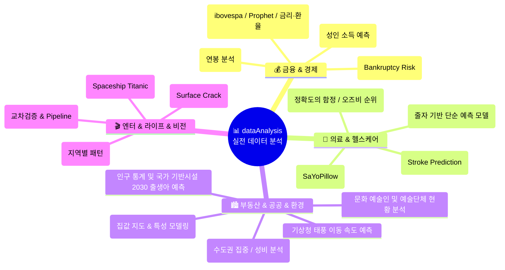

# 📊 데이터 알아가기 실전 분석 프로젝트 (dataAnalysis)

  
  
  
  
  
  
  

> **실제 비즈니스·의료·금융·공공 데이터셋으로 완성하는 실전 데이터 분석(EDA) & 머신러닝 포트폴리오!**  
> 캐글(Kaggle) 및 공공데이터 포털의 17개 이상 다양한 도메인 데이터를 기반으로 결측치 처리, 피처 엔지니어링, Plotly 인터랙티브 시각화, 교차검증 파이프라인, 예측 모델링을 수행한 실전 프로젝트 모음집입니다.  
> ⭐️ 학습에 도움이 되셨다면 우측 상단의 **Star** 버튼을 꾹 눌러주세요!

  <a href="#-도메인별-프로젝트-맵">🗺️ 도메인 맵</a> •
  <a href="#-프로젝트-마스터-인덱스-표">📋 마스터 인덱스</a> •
  <a href="#1-비즈니스--금융--경제-도메인">💰 금융·경제</a> •
  <a href="#2-의료--헬스케어-도메인">🏥 의료·헬스케어</a> •
  <a href="#3-부동산--공공--환경-도메인">🏙️ 공공·부동산</a> •
  <a href="#4-엔터테인먼트--라이프--인공지능">🎬 엔터·라이프</a>

---

## 🗺️ 도메인별 프로젝트 맵

---

## 📋 프로젝트 마스터 인덱스 표

모든 분석 프로젝트는 GitHub 소스코드(`.ipynb`), 브라우저에서 바로 열람 가능한 **HTML 뷰어**, 심화 추가 분석 링크를 지원합니다.

| No | 프로젝트명 | 도메인 | 분석 기법 / 주요 모델 | 데이터 출처 | 기본 분석 링크 | 심화 추가 분석 링크 |
|:---:|:---|:---:|:---|:---:|:---:|:---:|
| **01** | **데이터 과학자 연봉 분석 (2023)** | 취업·연봉 | 직무별/국가별 급여 통계, 시각화 | [Kaggle](https://www.kaggle.com/datasets/arnabchaki/data-science-salaries-2023) | [💻 GitHub](https://github.com/LDJWJ/dataAnalysis/blob/main/01_19_DataScienceSalaries_Analysis_2305.ipynb) · [🌐 HTML](https://ldjwj.github.io/dataAnalysis/01_19_DataScienceSalaries_Analysis_2305.html) | — |
| **02** | **캘리포니아 주택 가격 분석** | 부동산 | 지리 시각화, 회귀 모델링 | Colab Sample | [💻 GitHub](https://github.com/LDJWJ/dataAnalysis/blob/main/01_01_california.ipynb) · [🌐 HTML](https://ldjwj.github.io/dataAnalysis/01_01_california.html) | [🌐 1편: 집값 지도](https://ldjwj.github.io/dataAnalysis/01_01B_california_Price_Map.html) · [🌐 2편: 특성 모델](https://ldjwj.github.io/dataAnalysis/01_01C_california_Feature_Models.html) |
| **03** | **캐글 코리아 4차 성인 소득 예측** | 소득·분류 | 특성공학, One-Hot, LightGBM | [Kaggle](https://www.kaggle.com/c/kakr-4th-competition) | [🌐 상위 솔루션 분석](https://ldjwj.github.io/ML_Basic_Class/part03_ml/part03_pro_kaggle/kaggle_contest_4th_05_1st_review.html) | — |
| **04** | **뇌졸중(Stroke) 발병 예측** | 의료 | 불균형 데이터, 로지스틱/트리 | [Kaggle](https://www.kaggle.com/datasets/fedesoriano/stroke-prediction-dataset) | [💻 GitHub](https://github.com/LDJWJ/dataAnalysis/blob/main/01_02_Stroke_Prediction_Analysis_01.ipynb) · [🌐 HTML](https://ldjwj.github.io/dataAnalysis/01_02_Stroke_Prediction_Analysis_01.html) | [🌐 1편: 정확도 함정](https://ldjwj.github.io/dataAnalysis/01_02B_Stroke_Accuracy_Trap.html) |
| **05** | **은행 파산 위기 예측** | 금융 | 리스크 분류 모델링, 특성 변환 | [Kaggle](https://www.kaggle.com/competitions/bankruptcy-risk-prediction) | [💻 GitHub](https://github.com/LDJWJ/dataAnalysis/blob/main/01_03_Bankruptcy_Risk_Prediction02.ipynb) · [🌐 HTML](https://ldjwj.github.io/dataAnalysis/01_03_Bankruptcy_Risk_Prediction04_withkaggle_V10.html) | [📄 PDF 보고서](https://ldjwj.github.io/dataAnalysis/01_03_Bankruptcy_Risk_Prediction04_withkaggle_V10.pdf) |
| **06** | **Spaceship Titanic 예측** | 우주·분류 | 결측치 대체, 라벨 인코딩, 앙상블 | [Kaggle](https://www.kaggle.com/competitions/spaceship-titanic/data) | [🌐 HTML](https://ldjwj.github.io/dataAnalysis/01_04A_Spaceship_Titanic.html) · [📄 PDF](https://ldjwj.github.io/dataAnalysis/01_04A_Spaceship_Titanic.PDF) | — |
| **07** | **기상청 태풍 이동 속도 예측** | 기상 | 시계열 기상 관측 회귀 모델 | [기상청](https://data.kma.go.kr/data/weatherIssue/typList.do?pgmNo=724) | [💻 GitHub](https://github.com/LDJWJ/dataAnalysis/blob/main/01_05_Typhoon_analysis.ipynb) · [🌐 HTML](https://ldjwj.github.io/dataAnalysis/01_05_Typhoon_analysis.html) | — |
| **08** | **와인 품질(Wine Quality) 판별** | 식품·화학 | 다중 분류, 상관관계 분석 | [Kaggle](https://www.kaggle.com/datasets/yasserh/wine-quality-dataset?select=WineQT.csv) | [💻 GitHub](https://github.com/LDJWJ/dataAnalysis/blob/main/01_06_WindQT_DataAnalysis.ipynb) · [🌐 HTML](https://ldjwj.github.io/dataAnalysis/01_06_WindQT_DataAnalysis.html) | [🌐 1편: 교차검증 & 파이프라인](https://ldjwj.github.io/dataAnalysis/01_06B_WineQT_CrossVal_Pipeline.html) |
| **09** | **수면 센서 기반 인간 스트레스 감지** | 헬스케어 | 다중 센서 분류 (SaYoPillow) | [Kaggle](https://www.kaggle.com/datasets/laavanya/human-stress-detection-in-and-through-sleep?select=SaYoPillow.csv) | [💻 GitHub](https://github.com/LDJWJ/dataAnalysis/blob/main/01_07_Human_Stress_Detection.ipynb) · [🌐 HTML](https://ldjwj.github.io/dataAnalysis/01_07_Human_Stress_Detection.html) | [🌐 1편: 상관관계 & 결정트리](https://ldjwj.github.io/dataAnalysis/01_07B_Human_Stress_Correlation_Tree.html) |
| **10** | **브라질 증시(ibovespa) 주가 예측** | 증권·시계열 | 시계열 분석 & Meta Prophet | [Kaggle](https://www.kaggle.com/datasets/felsal/ibovespa-stocks) | [💻 GitHub](https://github.com/LDJWJ/dataAnalysis/blob/main/01_08_ivospa_stock.ipynb) · [🌐 HTML Prophet](https://ldjwj.github.io/dataAnalysis/01_08B_ivospa_stock_Prophet.html) | [🌐 1편: 금리·환율과 주가](https://ldjwj.github.io/dataAnalysis/01_08D_ibovespa_Rates_FX_Stock.html) |
| **11** | **남성 신체 치수 기반 체지방률 예측** | 건강·피트니스 | 다중 선형회귀, 다중공선성 진단 | [Kaggle](https://www.kaggle.com/datasets/fedesoriano/body-fat-prediction-dataset) | [💻 GitHub](https://github.com/LDJWJ/dataAnalysis/blob/main/01_09_bodyFatPredict.ipynb) · [🌐 HTML](https://ldjwj.github.io/dataAnalysis/01_09_bodyFatPredict.html) | [🌐 1편: 줄자 기반 단순 모델](https://ldjwj.github.io/dataAnalysis/01_09B_bodyFat_Simple_Tape_Model.html) |
| **12** | **CDC 40만 성인 심장병 핵심 지표** | 의료·역학 | 대용량 설문 데이터 이진 분류 | [Kaggle](https://www.kaggle.com/datasets/kamilpytlak/personal-key-indicators-of-heart-disease) | [💻 GitHub](https://github.com/LDJWJ/dataAnalysis/blob/main/01_10_Heart_Disease.ipynb) · [🌐 HTML](https://ldjwj.github.io/dataAnalysis/01_10_Heart_Disease.html) | [🌐 1편: 임계값 조정](https://ldjwj.github.io/dataAnalysis/01_10B_Heart_Disease_Accuracy_Trap_Modeling.html) · [🌐 2편: 오즈비 순위](https://ldjwj.github.io/dataAnalysis/01_10C_Heart_Disease_Risk_Factors.html) |
| **13** | **MCU 마블 영화 박스오피스 흥행 분석** | 엔터테인먼트 | 전세계 흥행 수익 비교, 시각화 | [Kaggle](https://www.kaggle.com/datasets/mayureshkoli/mcu-worldwide-box-office-collection) | [💻 GitHub 모델](https://github.com/LDJWJ/dataAnalysis/blob/main/01_11_MCU_MOVIE_INFO.ipynb) · [🌐 HTML EDA](https://ldjwj.github.io/dataAnalysis/01_11_MCU_MOVIE_INFO_02.html) | [🌐 1편: 지역별 패턴 & 수익률](https://ldjwj.github.io/dataAnalysis/01_11B_MCU_Regional_Box_Office_Patterns.html) |
| **14** | **인구 통계 및 국가 기반시설 분석** | 공공·인구 | 장기 인구변화 & 2030 출생아 예측 | KOSIS / 국토부 | [🌐 HTML EDA](https://ldjwj.github.io/dataAnalysis/01_12_Population_Analysis01_EDA.html) · [📄 PDF](https://ldjwj.github.io/dataAnalysis/01_12_Population_Analysis01_EDA.pdf) | [🌐 2030년 출생자수 예측](https://ldjwj.github.io/dataAnalysis/01_12_Population_Analysis02.html) |
| **15** | **문화 예술인 및 단체 현황 분석** | 문화·통계 | 예술기획업 등록 추이 및 아카이브 | 한국콘텐츠진흥원 | [🌐 HTML EDA](https://ldjwj.github.io/dataAnalysis/01_14_Artist_Kor_analysis01_EDA.html) | — |
| **16** | **행정안전부 주민등록 인구통계** | 공공·통계 | 연령대별/지역별 인구 분포 분석 | 행정안전부 | [🌐 HTML](https://ldjwj.github.io/dataAnalysis/01_15_Population_Data.html) | [🌐 1편: 수도권 집중 & 성비](https://ldjwj.github.io/dataAnalysis/01_15B_Population_Data_Analysis.html) |
| **17** | **콘크리트 표면 균열 검출 (CV)** | 건축·비전 | 2만 장 이미지 데이터셋 균열 검출 | [Kaggle](https://www.kaggle.com/datasets/arunrk7/surface-crack-detection) | 준비 중 | — |

---

## 💰 1. 비즈니스 · 금융 · 경제 도메인

* **Data Science Salaries 2023 (데이터 과학자 연봉)**:
  * 2023년 데이터 사이언티스트, 엔지니어, 애널리스트의 전세계 직무별·경력별·회사 규모별 연봉 비교 분석.
  * [💻 GitHub 코드](https://github.com/LDJWJ/dataAnalysis/blob/main/01_19_DataScienceSalaries_Analysis_2305.ipynb) · [🌐 HTML 리포트](https://ldjwj.github.io/dataAnalysis/01_19_DataScienceSalaries_Analysis_2305.html)
* **은행 파산 위기 예측 (Bankruptcy Risk Prediction)**:
  * 재무 비율 데이터를 바탕으로 기업/개인의 파산 위험성을 사전 예측하는 리스크 관리 모델.
  * [🌐 HTML 기초](https://ldjwj.github.io/dataAnalysis/01_03_Bankruptcy_Risk_Prediction01_v10_220518.html) · [🌐 HTML 모델링](https://ldjwj.github.io/dataAnalysis/01_03_Bankruptcy_Risk_Prediction04_withkaggle_V10.html) · [📄 PDF](https://ldjwj.github.io/dataAnalysis/01_03_Bankruptcy_Risk_Prediction04_withkaggle_V10.pdf)
* **브라질 주식 거래소(ibovespa) 시계열 분석 & Prophet 예측**:
  * 주가 추세, 이동평균선 탐색 및 Meta Prophet 미래 주가 예측.
  * [💻 GitHub 기본](https://github.com/LDJWJ/dataAnalysis/blob/main/01_08_ivospa_stock.ipynb) · [🌐 HTML Prophet](https://ldjwj.github.io/dataAnalysis/01_08B_ivospa_stock_Prophet.html)
  * **[추가 분석]** 금리·환율과 주가 상관/시차 상관 및 정답 누수 점검: [🌐 HTML 추가분석](https://ldjwj.github.io/dataAnalysis/01_08D_ibovespa_Rates_FX_Stock.html)

---

## 🏥 2. 의료 · 헬스케어 도메인

* **뇌졸중(Stroke) 발병 예측**:
  * 나이, 고혈압, 심장질환 여부, 흡연 상태 등 라이프스타일 변수를 바탕으로 뇌졸중 발병 확률 분류.
  * [💻 GitHub 코드](https://github.com/LDJWJ/dataAnalysis/blob/main/01_02_Stroke_Prediction_Analysis_01.ipynb) · [🌐 HTML 기본](https://ldjwj.github.io/dataAnalysis/01_02_Stroke_Prediction_Analysis_01.html)
  * **[추가 분석]** 정확도의 함정 ① - 불균형 데이터 오차행렬, ROC-AUC, 임계값 탐색: [🌐 HTML 추가분석](https://ldjwj.github.io/dataAnalysis/01_02B_Stroke_Accuracy_Trap.html)
* **수면 중 인간 스트레스 감지 (SaYoPillow)**:
  * 수면 자세, 체온, 심박수 센서 데이터를 결합하여 스트레스 수준을 자동 판별.
  * [💻 GitHub 기본](https://github.com/LDJWJ/dataAnalysis/blob/main/01_07_Human_Stress_Detection.ipynb) · [🌐 HTML 기본](https://ldjwj.github.io/dataAnalysis/01_07_Human_Stress_Detection.html)
  * **[추가 분석]** 상관계수 히트맵 및 결정트리 기반 주요 변수 중요도 분석: [🌐 HTML 추가분석](https://ldjwj.github.io/dataAnalysis/01_07B_Human_Stress_Correlation_Tree.html)
* **CDC 심장병 주요 지표 분석 (Personal Key Indicators)**:
  * 40만 명의 방대한 미국 CDC 성인 설문조사 데이터를 활용한 고위험군 탐색.
  * [💻 GitHub 기본](https://github.com/LDJWJ/dataAnalysis/blob/main/01_10_Heart_Disease.ipynb) · [🌐 HTML 기본](https://ldjwj.github.io/dataAnalysis/01_10_Heart_Disease.html)
  * **[추가 분석 1편]** 정확도의 함정 ② - class_weight 및 임계값 최적화: [🌐 HTML 1편](https://ldjwj.github.io/dataAnalysis/01_10B_Heart_Disease_Accuracy_Trap_Modeling.html)
  * **[추가 분석 2편]** 위험 요인 분석과 로지스틱 회귀 오즈비(Odds Ratio) 순위 (Plotly): [🌐 HTML 2편](https://ldjwj.github.io/dataAnalysis/01_10C_Heart_Disease_Risk_Factors.html)
* **체지방률(Body Fat) 예측**:
  * 252명의 남성 신체 둘레 측정치를 바탕으로 정밀 체지방률을 도출하는 다중 회귀 모델링.
  * [💻 GitHub 기본](https://github.com/LDJWJ/dataAnalysis/blob/main/01_09_bodyFatPredict.ipynb) · [🌐 HTML 기본](https://ldjwj.github.io/dataAnalysis/01_09_bodyFatPredict.html)
  * **[추가 분석 1편]** 줄자로 잴 수 있는 1~3개 변수 조합 교차검증 단순 계산식 도출: [🌐 HTML 1편](https://ldjwj.github.io/dataAnalysis/01_09B_bodyFat_Simple_Tape_Model.html)

---

## 🏙️ 3. 부동산 · 공공 · 환경 도메인

* **캘리포니아 주택 가격 회귀 분석**:
  * 소득 수준, 해안가 접근성, 가구당 방 개수를 반영한 집값 예측 표준 벤치마크.
  * [💻 GitHub 기본](https://github.com/LDJWJ/dataAnalysis/blob/main/01_01_california.ipynb) · [🌐 HTML 기본](https://ldjwj.github.io/dataAnalysis/01_01_california.html)
  * **[추가 분석 1편]** 위경도 기반 캘리포니아 집값 지리 지도 시각화: [🌐 HTML 1편](https://ldjwj.github.io/dataAnalysis/01_01B_california_Price_Map.html)
  * **[추가 분석 2편]** 특성 선택 및 다중 회귀 모델 비교: [🌐 HTML 2편](https://ldjwj.github.io/dataAnalysis/01_01C_california_Feature_Models.html)
* **대한민국 인구 통계 & 국가 기반시설(도로/교량) 분석**:
  * 1970~2021년 장기 인구 데이터와 1926~2021년 완공된 교량/터널 통계를 결합하여 **2030년 출생아 수 전망 모델** 수립.
  

    
    
  

  * [🌐 HTML 탐색(EDA)](https://ldjwj.github.io/dataAnalysis/01_12_Population_Analysis01_EDA.html) · [🌐 HTML 2030예측](https://ldjwj.github.io/dataAnalysis/01_12_Population_Analysis02.html) · [📄 PDF](https://ldjwj.github.io/dataAnalysis/01_12_Population_Analysis01_EDA.pdf)
* **행정안전부 주민등록 인구통계**:
  * 2023년 10월 행정구역별 주민등록 인구 (총인구, 세대수, 성별) 분석.
  

    
  

  * [🌐 HTML 기본](https://ldjwj.github.io/dataAnalysis/01_15_Population_Data.html)
  * **[추가 분석 1편]** 수도권 집중도, 시도별 인구 순위, 성비·세대당 인구 Plotly 트리맵: [🌐 HTML 1편](https://ldjwj.github.io/dataAnalysis/01_15B_Population_Data_Analysis.html)
* **문화 예술인 및 단체 현황 분석**:
  * 대중문화예술기획업 등록 현황 및 디지털 아카이브 데이터 탐색.
  

    
  

  * [🌐 HTML 리포트](https://ldjwj.github.io/dataAnalysis/01_14_Artist_Kor_analysis01_EDA.html)
* **기상청 태풍 이동 속도 예측**:
  * 기상청 과거 태풍 경로 및 중심 기압 데이터를 활용한 이동 속도 예측.
  * [💻 GitHub 코드](https://github.com/LDJWJ/dataAnalysis/blob/main/01_05_Typhoon_analysis.ipynb) · [🌐 HTML 리포트](https://ldjwj.github.io/dataAnalysis/01_05_Typhoon_analysis.html)

---

## 🎬 4. 엔터테인먼트 · 라이프 · 인공지능

* **MCU 마블 영화 전세계 박스오피스 흥행 분석**:
  * 아이언맨부터 최신 마블 영화들의 제작비, 전세계 오프닝 및 누적 박스오피스 수익 비교 분석.
  * [💻 GitHub 모델](https://github.com/LDJWJ/dataAnalysis/blob/main/01_11_MCU_MOVIE_INFO.ipynb) · [🌐 HTML EDA](https://ldjwj.github.io/dataAnalysis/01_11_MCU_MOVIE_INFO_02.html)
  * **[추가 분석 1편]** 회귀 과적합 진단, 지역별 흥행 비중 및 예산 대비 수익률(ROI) Plotly 시각화: [🌐 HTML 1편](https://ldjwj.github.io/dataAnalysis/01_11B_MCU_Regional_Box_Office_Patterns.html)
* **와인 품질(Wine Quality) 판별**:
  * 산도, 알코올 도수, 잔당 등 물리화학적 특성 11가지를 조합한 와인 퀄리티 분류.
  * [💻 GitHub 기본](https://github.com/LDJWJ/dataAnalysis/blob/main/01_06_WindQT_DataAnalysis.ipynb) · [🌐 HTML 기본](https://ldjwj.github.io/dataAnalysis/01_06_WindQT_DataAnalysis.html)
  * **[추가 분석 1편]** k-fold 교차검증과 Scikit-learn Pipeline 모델 최적화: [🌐 HTML 1편](https://ldjwj.github.io/dataAnalysis/01_06B_WineQT_CrossVal_Pipeline.html)
* **우주선 타이타닉 (Spaceship Titanic) 승객 차원 이동 예측**:
  * 결측치 보정, 파생 변수 엔지니어링을 통한 캐글 컴피티션 실전 모델링.
  * [🌐 HTML 리포트](https://ldjwj.github.io/dataAnalysis/01_04A_Spaceship_Titanic.html) · [📄 PDF](https://ldjwj.github.io/dataAnalysis/01_04A_Spaceship_Titanic.PDF)

---

## 🔗 라이선스 및 문의

* **문의 사항**: 데이터 분석 협업 및 제휴 문의: [frontier1020@naver.com](mailto:frontier1020@naver.com)
* **라이선스**: 본 저장소의 모든 자료는 [CC BY-NC 4.0](LICENSE) 라이선스를 따릅니다. 출처를 표시하면 비영리 목적으로 자유롭게 활용하실 수 있습니다.
